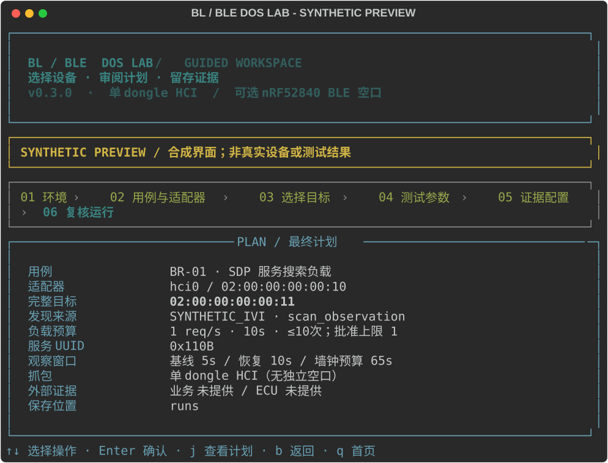
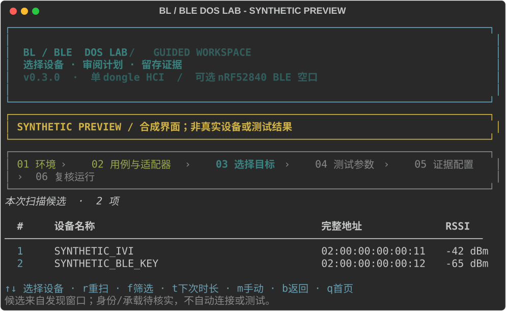
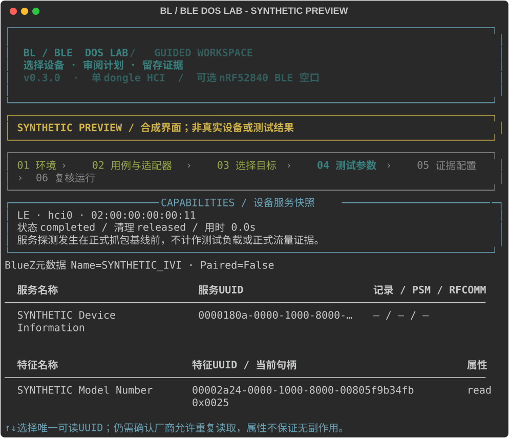

# bl-ble-dos

**把蓝牙可用性测试做成有边界、可追溯、可复核的一次运行。**


[English](README.en.md) · [使用指南](docs/usage.md) · [硬件边界](docs/hardware.md) · [证据与报告](docs/evidence.md) · [参与开发](CONTRIBUTING.md)

面向 Ubuntu / Kali 的 BR/EDR 与 Bluetooth LE 有界负载和可用性观察工具。一个 Bash 入口、一个 Rich + prompt_toolkit 终端向导，使用常见 USB 双模蓝牙适配器发起正常协议交互，同时保存本机 HCI 流量；可另接已刷入 sniffer 固件的 nRF52840，补充 BLE 空口观察。

> **开发预览，0.3.0 尚未发布。** 徽章仅描述项目定位，不表示 CI、硬件兼容或认证结果。合成 demo 与真实硬件运行严格区分；尚无已验证的适配器/被测设备兼容性结论。Kali 实机验证状态以可复核的测试记录为准。



## 为什么使用它

- **六步可回退向导**：环境 → 用例与适配器 → 目标 → 参数 → 证据 → 复核；可返回、分区修改和查看 JSON，不必从头填写。
- **显式扫描选目标**：限时扫描、冻结候选表、编号选择，支持重扫、筛选和翻页；也可手动输入或保留当前目标，不会因进入页面自动连接或测试。
- **方向键与可编辑字段**：菜单用 ↑↓ / Enter，文字用 ←→、Home/End、Backspace/Delete；字段历史只在当前进程内存中保留。
- **主动获取服务再选参数**：目标页先展示已知元数据，不自动连接；参数页主动确认后获取 SDP / GATT 服务快照，支持列表选择或高级手动输入。
- **有界而非无限发送**：默认每秒 1 次请求；速率、持续时间、操作数和连接循环均设硬上限。
- **采集先于负载**：supervisor 等待 `btmon` 就绪后才启动 worker；关键采集失败会终止运行。
- **结论不越过证据**：本机请求成功不等于业务正常；缺少业务探针、ECU 观察或空口数据时明确记录缺口。
- **离线可演示、可复核**：`demo` 不接触硬件；运行目录包含计划快照、事件、报告和文件哈希清单。

## 快速开始

```bash
git clone https://github.com/addxemmm/bl-ble-dos.git
cd bl-ble-dos
chmod +x bt-dos scripts/install.sh
./scripts/install.sh
./bt-dos doctor
./bt-dos demo --output runs/demo
# 复制上一步输出的校验命令，或将 RUN_DIR 替换为实际运行目录
./bt-dos verify RUN_DIR
./bt-dos
```

`--output` 指定父目录，demo 在其下新建时间戳/随机子目录，并打印实际目录及可直接复制的校验命令。无参数在交互终端启动 Rich 向导，非交互输入/输出时显示帮助。先用 `demo` 熟悉输出，实际运行前按 `doctor` 提示准备 Linux、BlueZ、适配器和采集权限。安装脚本分六步检查环境、检查/可选安装系统依赖、准备 `.venv`、联网安装 Python 依赖、提示设备检查、验证并给出下一步。默认不运行 apt，也不自动启用蓝牙服务；`--install-system` 才显式允许 apt 系统安装，`--non-interactive` 不等待输入，`--dev` 增加离线测试，`--help` 只显示帮助。无需全局安装 Python 包。详见[安装与运行](docs/usage.md)。

## 四个测试场景

| 场景 | 交互范围 | 测试含义与边界 |
| --- | --- | --- |
| `br-sdp` | BR/EDR SDP 服务查询 | 有界服务发现请求；目标须提供相应服务 |
| `br-channel` | BR/EDR SDP PSM `0x0001` 的 L2CAP 信道循环 | 建立、保持、关闭信道，不发送业务负载；**不是** ACL 链路反复建立/释放测试 |
| `ble-read` | BLE GATT 特征读取 | 工具不发起写操作；读取副作用需厂家确认 |
| `ble-cycle` | BLE 顺序连接、保持、断开 | 有界连接生命周期观察；**不是**并发连接槽位耗尽 |

这些场景均为 **normal-protocol bounded workload**：不包含控制器漏洞注入、畸形底层帧、射频干扰或“任何蓝牙设备必定失效”的承诺。正常协议请求仍可能影响脆弱目标；应在目标隔离、停止条件和恢复手段已明确的实验环境运行。

默认请求预算为 `1 req/s × 10 s`、`max_ops=10`；快速预检为 `1 req/s × 5 s`、`max_ops=5`。显式配置 `max_ops=400` 的旧计划仍有效。硬上限不变：速率最高 `20 req/s`，且配置速率不高于计划中的 `approved_rate`；请求型负载的 `duration` 最长 `60 s`，最多 `400` 次操作。信道/连接循环最多 `10` 次，保持 `1–5 s`，循环间隔 `3–30 s`，另有连接与监督超时预算；不保证整个实验在 60 秒内完成。限值是项目的运行边界，**不是法规阈值，也不是目标承受能力保证**。

## 命令速览

```text
./bt-dos                         # 向导，等价于 wizard
./bt-dos doctor [--json]         # 本机环境诊断
./bt-dos adapters                # 适配器枚举
./bt-dos scan --transport le --adapter hci0 --seconds 5
./bt-dos scan --transport bredr --adapter hci0 --seconds 5
./bt-dos scan --transport le --adapter hci0 --seconds 5 --json
./bt-dos inspect --transport le --adapter hci0 --target TARGET --confirm TARGET
./bt-dos inspect --transport bredr --adapter hci0 --target TARGET --confirm TARGET
./bt-dos run --plan PLAN.json --confirm TARGET
./bt-dos report RUN_DIR
./bt-dos verify RUN_DIR
./bt-dos demo --output runs/demo
```

`TARGET`、`PLAN.json`、`RUN_DIR` 是占位符。实测目标须与计划及 `--confirm` 一致；BR/EDR 场景还需记录实际本地适配器地址。扫描与 `inspect` 也会触发蓝牙通信，不属于离线演示。

### 0.3.0 的交互与目标选择

向导目标页使用 `s` 扫描（默认 5 秒）、`m` 手动输入、`k` 保留当前目标。候选列表显示名称、完整 MAC、RSSI，宽屏额外显示配对状态及地址类型；`r` 每次只重扫一次，`f` 筛选，`t` 仅设置下次扫描为 1–15 秒，按 `r` 才重扫，`n` / `p` 翻页。列表中 `b` 返回选择方式，方式页 `b` 返回上一步；`q` 回首页，草稿仅保留于当前会话内存。首页演示或诊断完成后回到菜单。

菜单支持 ↑↓ 选择、Enter 确认，也保留所示快捷键；输入字段支持 ←→、Home/End、Backspace/Delete 和同字段的内存历史，不写入历史文件。`BTDOS_SIMPLE_INPUT=1 ./bt-dos` 使用简单输入备用模式，**该模式不支持方向键编辑**。安装更新后须退出旧进程再启动，运行中的旧向导不会热更新。

默认、快速预检和自定义预算均沿用现有协议硬上限。变更设备、适配器或传输会清除旧探测快照、SDP 服务和 GATT 特征选择（适配器/传输变化也清除目标）；须针对当前目标重新核对参数。最终复核可直接修改分区，或按 `j` 查看 JSON。



CLI `scan` 默认输出人读表格；脚本应使用 `--json` 获取含 `devices`、`status`、`cleanup_status`、`warnings` 的 `ScanResult`，这与 0.1 的默认输出不同。由于 BlueZ 多客户端发现过滤器合并，所有候选的 `transport_verified` 均为 `false`：只表示“在本次 LE / BR/EDR 扫描窗口观察到”，不是承载或目标身份证明。缓存未更新的设备不冒充本窗口新观察，空列表也不等于周围没有设备。

取消扫描会返回 `status: interrupted`，保留 `cleanup_status` 与 `warnings`，CLI 退出 `130`；清理状态 `unconfirmed` 不是普通成功。

扫描只在明确选择后启动，不调用 Connect / Pair、GATT 读写或测试负载；发现过程可含 inquiry、主动扫描和名称解析，并非“完全被动”。[操作与输出说明 →](docs/usage.md#4-诊断枚举与发现)

### 获取服务与选择参数



选择目标后只展示已知的名称、地址、配对等元数据，不自动连接。参数页 `p` 获取/刷新服务信息，明确确认默认 `n`，确认后才执行一次有界主动探测；`s` 从已探测结果选择，`m` 高级手动输入，`k` 保留已核对选择，循环类场景可直接继续而不探测。

SDP 只将 `ServiceClassIDList` 中可表示为 UUID16 的服务写入计划；自定义 UUID128 仅展示，PSM / RFCOMM channel 仅元数据，`br-channel` 始终使用 PSM `0x0001`。BLE 探测连接并枚举服务/特征，不读取值、不配对、不写入或订阅。只有具备 read 属性且 UUID 唯一的特征可列表选择，写入 UUID 而非易漂移的句柄；重复 UUID 须高级手动核对。正式读取前仍须厂家确认可读且无业务副作用。

探测是**抓包基线开始前的独立快照，不是本次测试证据**，向导只保留内存、不自动保存。CLI `inspect` 要求 `--confirm TARGET`，`--json` 仅输出 JSON；需要保存时自行重定向至私有文件。SDP 执行预算 15 秒（另有有限子进程清理），BLE 扫描/连接/断开预算分别 8/10/5 秒，D-Bus 每调用 5 秒；取消传播和库内清理可能超出预算。应用不自动重试，底层 Bleak/BlueZ 可能重试或复用；请使用独立控制器并停止其他客户端，前置状态检查不消除共享连接竞态。详细状态与限制见[主动能力探测](docs/usage.md#主动能力探测与私有-json-快照)。

## 硬件与证据边界

```text
Linux + BlueZ
  ├─ USB 双模适配器 ── BR/EDR 或 BLE 正常交互 ── TARGET
  │       └─ btmon → host-hci.btsnoop（本机 HCI 视角）
  └─ 可选 nRF52840 + sniffer 固件 → air.pcap（BLE 空口视角）
```

- 单 USB 双模适配器可作为 BR/EDR、BLE 主动通信端；本项目按场景顺序运行，不把它描述成通用空口分析仪。
- `btmon` 是主机—控制器接口观察，既不等于全部射频流量，也不覆盖目标内部业务和 ECU 状态。
- nRF52840 有两种**互斥固件角色**：sniffer 固件用于 BLE 空口采集；匹配板型的 Zephyr HCI USB controller 固件在 Linux 枚举为 `hciX` 后，可选作 `ble-read` / `ble-cycle` 的主动适配器并使用 `btmon`。它是 LE-only，不用于 BR/EDR；同一块板不同时承担两种角色。项目不自动刷固件，nRF 真实兼容性尚未验证。[角色与准备 →](docs/hardware.md#nrf52840两种互斥角色)
- Windows 用于代码、文档和发布管理；实际蓝牙运行面向 Linux。虚拟机需独占 USB 直通，不能据 Windows 能识别设备推断 Linux 测试通过。

[硬件准备与故障定位 →](docs/hardware.md)

[已完成验证与尚待现场确认的范围 →](docs/validation.md)

## 权限模型

向导、计划、worker、报告以普通用户运行。交互向导在完整目标 MAC 确认后，可在当前 TTY 调用原生 `sudo -v`，密码由系统 sudo 读取，不经过应用保存；非交互 `run` 仍需预先执行 `sudo -v`。仅由采集子进程使用 `sudo -n btmon`。项目不自动修改 sudoers、不设置 `setcap`，也不要求将整个 TUI 作为 root 启动。BlueZ D-Bus 和串口访问遵循当前系统的策略；先用 `doctor` 检查。

## 运行产物

```text
RUN_DIR/
├── plan.json             # 本次计划快照
├── events.jsonl          # supervisor 生命周期事件
├── worker.jsonl          # 协议操作与结果
├── result.json           # 运行状态、统计与采集元数据
├── host-hci.btsnoop      # 真实运行的原始 HCI 采集
├── air.pcap              # 可选 BLE 空口采集
├── report.md             # 范围、观察、缺口与结论
└── manifest.json         # 文件哈希清单
```

演示目录使用显著的 simulation 标识，包含合成事件与报告，**不生成伪造的 HCI/PCAP**。哈希校验只说明文件与清单一致，不证明采集完整、目标无故障或符合认证要求。[证据解释 →](docs/evidence.md)

若采集写入进程退出未确认，目录标记 `UNSEALED.json` 且不生成 `manifest.json`；确认退出但需要强制清理时记录 `cleanup_forced`，不自动当作成功完成。

## 法规定位

本工具为风险导向的测试活动提供部分记录，**不是 GB 44495 或 UN R155 认证工具**。GB 44495-2024 及其第 1 号修改单应一并核对；UN R155 附录 5 的威胁条目 8.1 与缓解措施 M13 关注拒绝服务风险及检测、恢复。这里的默认速率和上限不是它们规定的统一 PPS 条款；适用范围、负载与判据仍由整车风险分析和试验方案确定。详见[官方依据及映射限制](docs/evidence.md#法规映射)。

## 开发与贡献

```bash
./scripts/install.sh --dev
.venv/bin/python -m unittest discover -s tests -v
```

欢迎提交可复现的故障、带证据的兼容性记录和小而明确的改进。提交前阅读 [CONTRIBUTING.md](CONTRIBUTING.md)；安全问题按 [SECURITY.md](SECURITY.md) 私下报告。变更见 [CHANGELOG.md](CHANGELOG.md)。

MIT © 2026 addxemmm。见 [LICENSE](LICENSE)。
